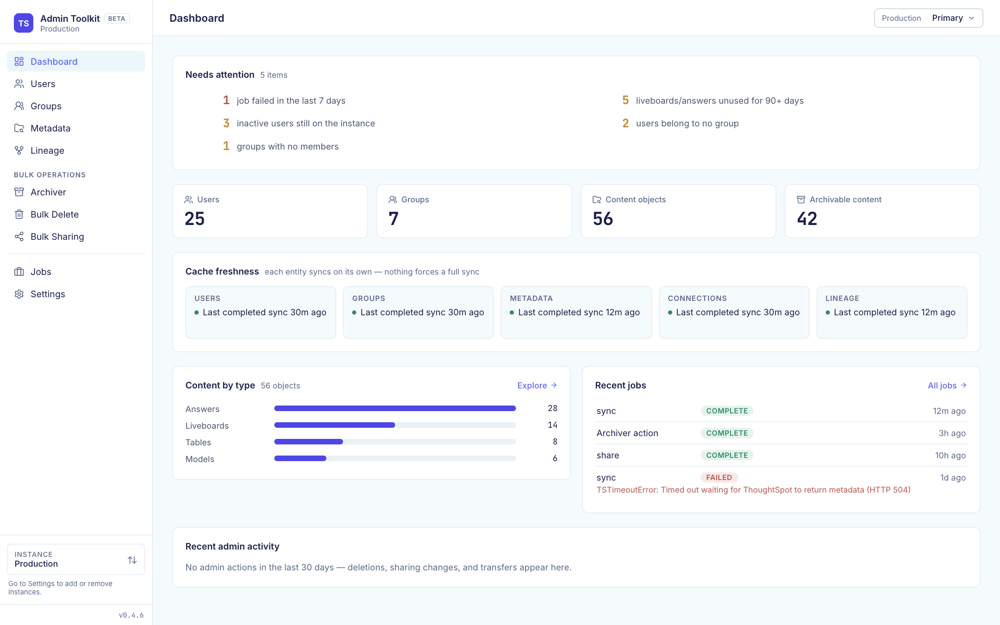
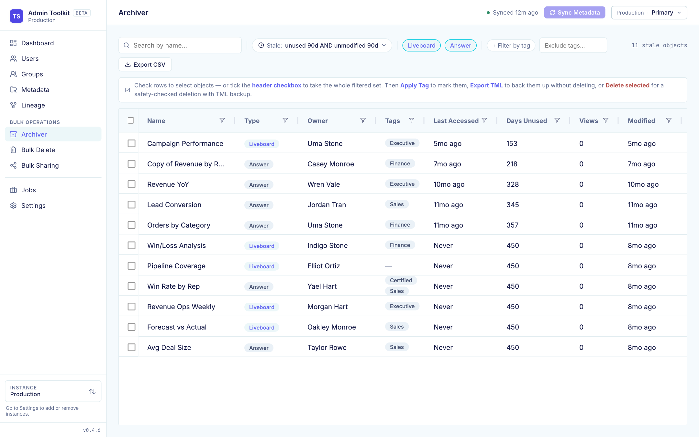
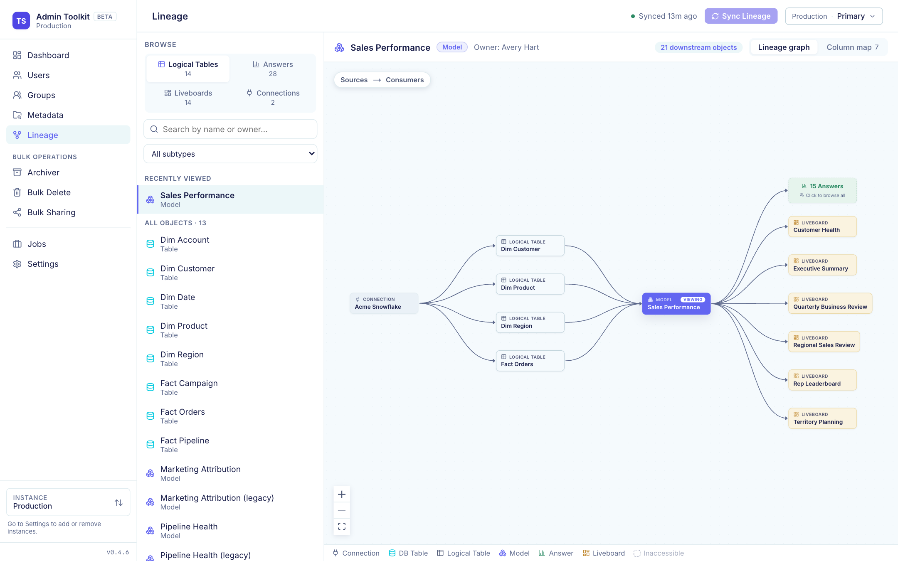
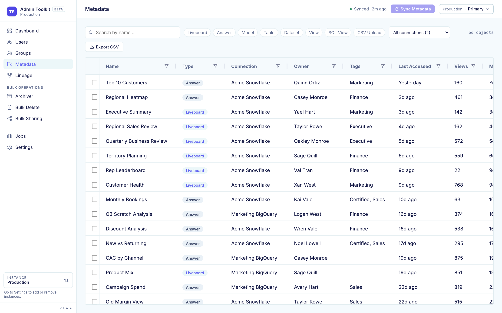
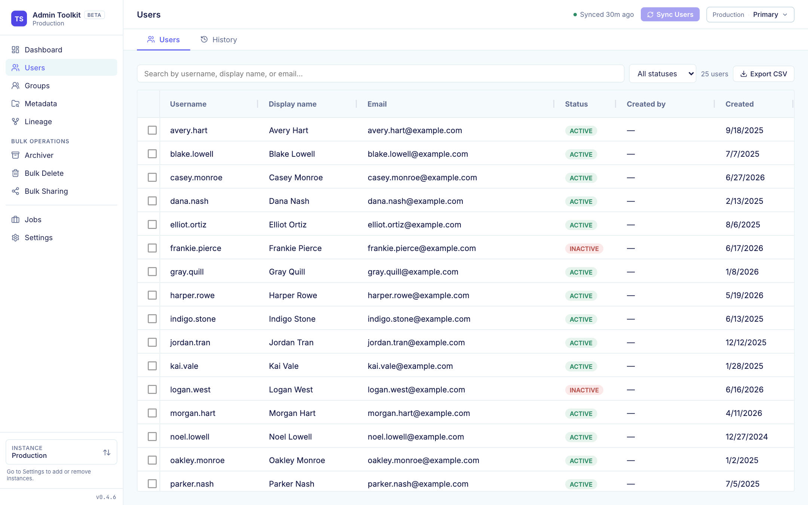

# ThoughtSpot Admin Toolkit

**Find stale content, clean up leavers, and see what depends on what, without writing a script.**

A local web app for ThoughtSpot admins. It caches your instance's users, groups and content, so you can browse instantly, then run bulk changes (archive, delete, share, transfer ownership) with a dry-run preview and a TML backup first.

> **Community tool, not a ThoughtSpot product.** Not supported by ThoughtSpot, provided as-is with no warranty. Test on a non-production instance first. Questions and bugs go to this repo's GitHub issues, never to ThoughtSpot Support.



---

## Quick start

```bash
# macOS / Linux
curl -LsSf https://raw.githubusercontent.com/kunalghate/thoughtspot-admin-toolkit/main/install.sh | sh

# Windows (PowerShell)
powershell -ExecutionPolicy Bypass -c "irm https://raw.githubusercontent.com/kunalghate/thoughtspot-admin-toolkit/main/install.ps1 | iex"

ts-admin-toolkit serve    # opens http://localhost:8080
```

No Python or Node.js needed; the installer brings its own. You need a ThoughtSpot instance (Cloud or Software) and a login with the `ADMINISTRATION` privilege.

On first launch, enter your instance URL and credentials (Basic, Trusted Auth or Bearer token) and click **Test connection**. Credentials go to your OS keychain. Everything is configured in the browser.

<details>
<summary>Install with uv or pip instead</summary>

Releases are wheels on [GitHub Releases](https://github.com/kunalghate/thoughtspot-admin-toolkit/releases), not PyPI:

```bash
uv tool install https://github.com/kunalghate/thoughtspot-admin-toolkit/releases/latest/download/<wheel>
```

</details>

---

## What you can do

| Feature | What it does |
|---|---|
| **Dashboard** | What needs attention (failed jobs, orphaned content, inactive users, empty groups), content totals, and when each cache last synced. |
| **Metadata Explorer** | Search and filter all content by owner, tag, last accessed and views. |
| **Content Archiver** | Find stale liveboards and answers, tag them, delete with TML backup, restore from History. |
| **Content Deleter** | Delete by GUID or search, with dependency resolution. |
| **User Management** | Transfer ownership, transfer sharing, bulk delete. A read-only drawer shows each user's groups and effective privileges. |
| **Group Management** | Browse groups, privileges, members, and who created each group. Read-only. |
| **Bulk Sharing** | Share content to users and groups in bulk, with an impact preview. |
| **Lineage** | Content dependency graph, plus column-level lineage from a model column back to its physical table and forward to every consumer. |
| **Jobs** | Every sync and bulk operation is a tracked background job with live progress. |
| **Diagnostics** | Tail logs and download a support bundle with no credentials in it. |
| **Multi-instance** | Several ThoughtSpot instances, each with its own cache, one picker in the sidebar. |

<table>
  <tr>
    <td><br><sub><b>Content Archiver</b>: stale content, tag or delete with TML backup</sub></td>
    <td><br><sub><b>Lineage</b>: connection to table to model to liveboards</sub></td>
  </tr>
  <tr>
    <td><br><sub><b>Metadata Explorer</b>: filter all content by owner, tag, views</sub></td>
    <td><br><sub><b>User Management</b>: transfer, share, bulk delete</sub></td>
  </tr>
</table>

Screenshots use sample data.

---

## Safety

- **Dry-run first.** Every destructive action previews its full impact before you confirm.
- **TML backup.** Deletions are backed up to `~/.ts-admin/tml-exports/` and can be restored.
- **Live check.** Writes are re-verified against ThoughtSpot at execution time, not against the cache.
- **Audit log.** Every write is recorded.
- **Local only.** Binds to `127.0.0.1`, rejects private or non-HTTPS instance URLs, and keeps secrets in the OS keychain.

You still own what you run. These tools change a live instance.

---

## How it works

The toolkit talks to the public [ThoughtSpot REST API v2](https://developers.thoughtspot.com/docs/rest-api-getstarted) and mirrors users, groups, metadata and lineage into a local SQLite database. Browsing reads the cache. Writes go straight to ThoughtSpot. Each entity syncs on its own, so you never have to run a full sync.

Details: [How sync works](docs/user/SYNC.md) · [Getting started](docs/user/GETTING_STARTED.md) · [Architecture](docs/dev/ARCHITECTURE.md)

---

## Updating

An **Update available** pill appears in the top bar when a new release is out. It never updates itself.

```bash
# stop the app (Ctrl+C), then:
ts-admin-toolkit update
ts-admin-toolkit serve
```

Your instances, sign-ins and synced data live outside the app and are untouched. Check your version with `ts-admin-toolkit --version`.

---

## Troubleshooting

**Settings → Diagnostics** shows recent logs and downloads a support bundle (logs, recent failed jobs, version info, no passwords, tokens or ThoughtSpot data).

---

## Development

```bash
ts-admin-toolkit serve --dev   # FastAPI :8000 + Next.js :3000, hot reload (needs Node.js)
```

See [CONTRIBUTING.md](docs/dev/CONTRIBUTING.md).

---

## Known limits

- Single-admin local use, no web login in v1.
- Built on the public API only; ThoughtSpot may change it without notice and break things.
- Group writes and scheduled workflows are not supported yet. See [TODOS](docs/dev/TODOS.md).
